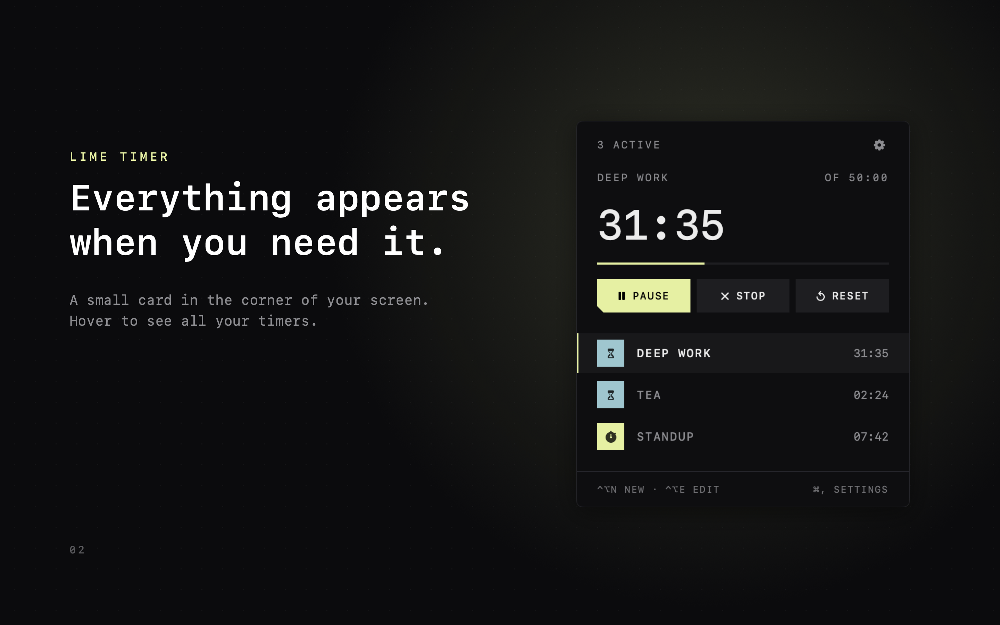

# Lime Timer

**A timer you control entirely from your keyboard.**

Lime Timer is a tiny timer that floats in the corner of your Mac's screen. Start, pause, stop and edit
timers from any app with a keystroke — no switching windows, no reaching for the mouse. It stays a small,
quiet card until you hover over it.



## Keyboard shortcuts

Every shortcut works from any app, at any time.

| Keys | Action |
|---|---|
| `⌃⌥N` | New timer — type `25m focus`, `1h30 deep work`, `90s`, `1:30` or `45` (minutes), then Return. Blank = stopwatch. |
| `⌃⌥P` | Pause / resume |
| `⌃⌥S` | Stop |
| `⌃⌥R` | Restart |
| `⌃⌥E` | Edit the time (Return restarts at the new time, Esc cancels) |
| `⌃⌥J` / `⌃⌥K` | Switch between timers |
| `⌃⌥H` | Hide / show |
| `⌃⌥,` | Settings (`⌘,` while focused) |
| `⌘Q` | Quit (while focused) |

Shortcuts use the Carbon hot-key API, so no Accessibility permission is needed. Change them in the
`hotkeys` table at the top of `Sources/main.swift`.

## Features

- Countdowns and stopwatches, as many as you like, with a running total of paused time
- Chime, shake and red border when a countdown ends; a "ta-ding" when you stop one
- Adjustable background opacity and blur, draggable card that remembers its position
- No Dock icon, no account, no network access

## Building

Requires macOS 13+ and Xcode (or the command-line tools) for `swiftc`.

```sh
./build.sh             # dev build → build/QuickTimer.app
./build.sh --install   # …and copy to ~/Applications and launch
./build-appstore.sh    # App Store variant → build/appstore-test/Lime Timer.app (sandboxed, opens locally)
```

The whole app is one file, `Sources/main.swift`. The two builds have full feature parity and differ in exactly one place: the dev build
(`QuickTimer`) uses a private window-server call for an adjustable Gaussian blur, while the App Store build
(`-D APPSTORE`) uses only public APIs and has an on/off blur instead.

`build-appstore.sh --release` signs and packages the App Store build; it needs your own distribution
certificates and a provisioning profile at `appstore/embedded.provisionprofile` (not included).

## Links

- [Website & support](https://cryosnake22.github.io/lime-timer/)
- [Privacy policy](https://cryosnake22.github.io/lime-timer/privacy.html) — Lime Timer collects no data.

## License

MIT — see [LICENSE](LICENSE).
